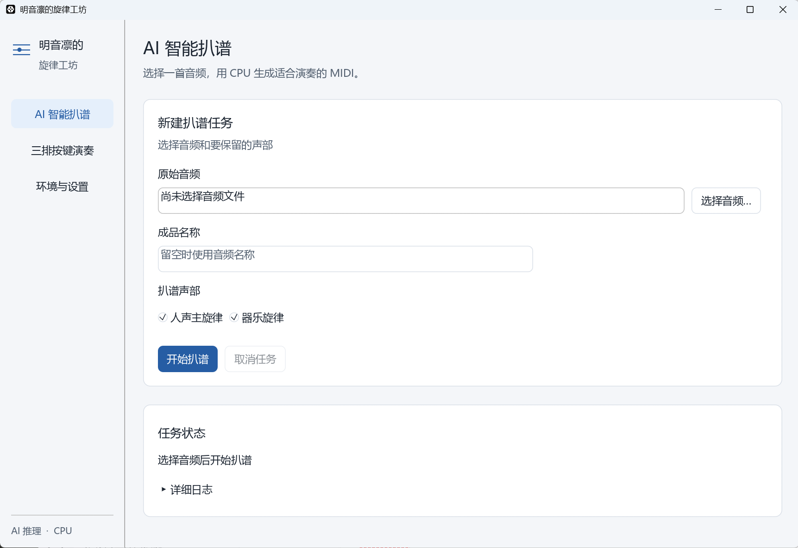
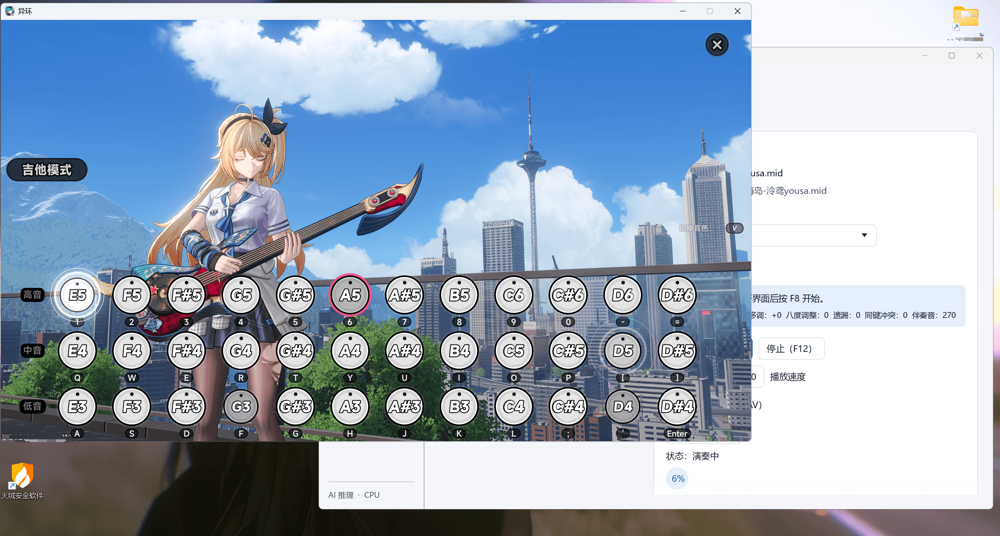

# 异环吉他自动演奏 | NTE Guitar MIDI

**明音凛的旋律工坊**是一款 Windows 桌面工具：将歌曲或纯音乐转换为 MIDI，在《异环》（Neverness to Everness，NTE）游戏的三排音符界面自动演奏吉他旋律。支持导入 MIDI、CPU 智能扒谱、简化伴奏和录制系统声音。

关键词：异环自动演奏、异环吉他、异环扒谱、音频转 MIDI、游戏 MIDI 播放器、Neverness to Everness guitar player、NTE MIDI、audio to MIDI。


## 软件截图

AI 智能扒谱界面：



游戏内三排按键演奏：



作者：xuasas  
项目地址：[github.com/xuasas/nte-guitar-midi](https://github.com/xuasas/nte-guitar-midi)。
## 功能

- 使用本地 SheetSage2 模型和 CPU 从音频生成 MIDI；不要求 NVIDIA 显卡。
- MIDI 曲库支持导入、搜索、选择主旋律音轨和删除到回收站。
- 自动调整音域，按需添加简化伴奏，在游戏的三排按键界面演奏。
- F8 开始或暂停，F12 停止；失去游戏焦点时暂停并释放已按下的按键。
- 支持系统声音录制（WAV）、深色和浅色界面。

## Windows 快速开始

也可以从 [Releases 发布页面](https://github.com/xuasas/nte-guitar-midi/releases) 下载 Windows 测试版安装程序。

1. 在 GitHub 仓库页面选择 **Code → Download ZIP**，将 ZIP **完整解压**到可写目录。也可以通过 `git clone` 获取。
2. 双击目录里的 **明音凛的旋律工坊.exe**。不要只复制 EXE；其旁边的 `setup`、`vendor`、`transcriber` 和 `rust_app` 等目录需要一起保留。
3. 如果只演奏已有 MIDI，可在“三排按键演奏”直接导入。使用音频扒谱时，在“环境与设置”点击 **安装 / 修复模型环境**，等待首次安装完成。安装需要网络和数 GB 磁盘空间；模型权重本身约 2.6 GB，Python 和其他依赖还会占用额外空间。
4. 在“AI 智能扒谱”选择音频并开始；完成后切换到演奏台。也可以直接导入自己的 `.mid` 或 `.midi`。
5. 在游戏中打开**三排音符界面**，选好曲目，按 F8 开始或暂停；按 F12 停止。

**演奏权限：**如果游戏以管理员身份运行，请右键点击软件图标或 `明音凛的旋律工坊.exe`，选择 **以管理员身份运行**。两者权限不一致可能导致 F8 后立即暂停或游戏收不到按键。然后单击游戏窗口，进入三排音符界面，再按 F8。

如果安装报错，在“环境与设置”查看详细日志并重试。首次安装时，请保持窗口打开；下载速度取决于网络。

曲库自带 `黄昏之时-你的名字.mid`，可直接用于试听演奏；`assets/test_midis/sample_demo.mid` 是四音测试曲，可用于验证 MIDI 读取。AI 识别结果受音频混音、模型和游戏音域影响，请试听并按需选择主旋律音轨。

## 环境与文件

- `明音凛的旋律工坊.exe`：Windows x64 图形程序，仓库内提供以便解压后启动。
- `rust_app/`：Rust GUI、MIDI 编排、演奏、录音与 CPU 模型桥接源码。
- `setup/`、`transcriber/`、`vendor/sheetsage2/`：首次安装和当前 SheetSage2 扒谱所需脚本。
- `songs/`、`out/`、`player/录音/`、`logs/`：保存运行过程中产生的个人文件；除内置测试曲外不纳入仓库。
- `.venv/`、`runtime/` 和 `vendor/sheetsage2/models/`：首次安装产生的运行环境和模型，不纳入仓库。

当前界面和 MIDI 演奏核心使用 Rust；音频扒谱暂通过独立 Python 进程调用 CPU 模型。因而安装后的完整目录仍会有数 GB 大小，不建议把运行环境或模型权重上传到 GitHub。

## 从源码构建

需要 Windows x64、Rust 和 MSVC 构建工具。在 `rust_app` 中执行：

```powershell
cargo test --workspace
cargo build --release
```

构建产物位于 `rust_app/target/release/mingyin-workbench.exe`。程序需要与上述项目文件一起使用；不要将产物单独拷贝到没有项目资源的目录。源码版本与仓库内的 EXE 不一致时，以重新构建的程序为准。

## 授权与说明

项目原创代码遵循根目录的 MIT 许可证；`vendor/sheetsage2/patched_model_py/` 包含基于第三方模型代码的修改，第三方代码、组件与素材遵循各自许可，参见 `NOTICE` 和 `licenses/`。公开再分发前，请核对模型作者对这些代码的授权。SheetSage2 和 MERT 模型权重标注为 **CC BY-NC 4.0，仅限非商业用途**，首次安装时从上游下载；请阅读模型作者的许可。软件与游戏官方无关。
